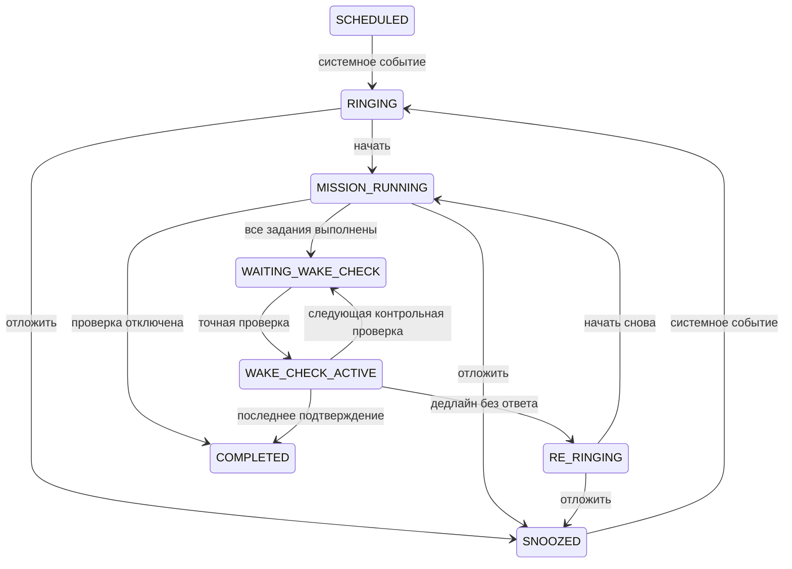

# Архитектура и границы надёжности

`core` — чистый Kotlin: локальное расписание, генерация заданий и reducer WakeMachine.
`app` — Android-адаптеры, Room, DataStore, CameraX, Compose.

## Источник истины

В Room хранится каждый экземпляр будильника с UUID, неизменяемым снимком настроек,
временем звонка, прогрессом задания, завершением задания, дедлайном, циклом,
числом откладываний, состоянием и версией. ViewModel читает Flow и отправляет команды.
UI-таймер нужен только для отображения цифр.

Любое нетерминальное состояние можно осознанно отменить. Аварийное завершение
помечается в истории. «Назад» закрывает только экран.

## Планирование

- `AlarmManager.setAlarmClock()` ставит основной звонок, snooze, проверку и её дедлайн.
- URI PendingIntent содержит UUID экземпляра и версию. Старое событие не меняет
  обновлённое состояние. Повторная обработка одной версии идемпотентна.
- Следующее недельное срабатывание создаётся в той же Room-транзакции, что и запуск
  текущего. Однократный будильник становится выключенным при первом запуске.
- Один Mutex сериализует команды в единственном процессе приложения. Несколько
  событий сохраняются независимо; звук играет для самого раннего активного звонка.
- База и AlarmManager не имеют общей транзакции. После записи выполняется
  согласование системных событий; при запуске приложения, перезагрузке, обновлении
  и восстановлении службы оно повторяется. Служба читает состояние после завершения
  согласования, чтобы не остановиться между записью проверки и её постановкой.
  Абсолютная атомарность между ОС и SQLite не обещается.
- Ошибка постановки сохраняется в диагностике, выводится на главную и в уведомление.
- `TIME_SET`/`TIMEZONE_CHANGED` пересчитывают будущие основные звонки по местному времени.
  Для snooze и проверок сохраняется монотонный якорь с номером загрузки: перевод часов
  в рамках одной загрузки не удлиняет интервал. После перезагрузки используется UTC.
- DST: пропущенное локальное время сдвигается вперёд, при повторении часа выбирается
  первое смещение; второй звонок в тот же локальный день не создаётся.
- Просроченный сохранённый звонок после перезагрузки доставляется немедленно. Уже
  истёкшее окно проверки ведёт к повторному сигналу, а не к новому полному окну ответа.
- Пропуск следующего звонка сохраняет следующий рассчитанный экземпляр. Изменение
  системного времени или зоны пересчитывает расписание и отменяет этот перенос;
  после смены зоны при необходимости пропустите звонок заново.

## Direct Boot и приватность

`runtime.db` в Device Protected Storage содержит минимальные настройки расписания,
типы и параметры заданий, обезличенные идентификаторы, прогресс и времена событий.
Название, фраза, QR-значение и URI мелодии находятся в `private.db` в Credential
Protected Storage. Их версии неизменяемы: редактирование завтра не меняет задание
уже звонящего экземпляра. Дневник сна и DataStore тоже находятся в CP storage.

До первой разблокировки после загрузки доступны встроенный сигнал, вибрация,
сохранённое расписание и задания без личных данных. Для QR и собственной фразы
нужно разблокировать устройство. Встроенный сигнал заменяет недоступный личный звук.
Скрытой копии QR/фразы в DP storage нет. Резервное копирование Android отключено;
пользователь сам экспортирует JSON через SAF. Такой файл содержит личные значения.

## Звук, служба и ресурсы

Служба `systemExempted` применима к приложению с разрешением точных будильников.
Она стартует из точного alarm broadcast, сразу вызывает startForeground и
воспроизводит звук с USAGE_ALARM. Это не постоянная служба ожидания.

Короткий WakeLock ограничен 30 секундами для доставки/инициализации (20 секунд при
восстановлении). MediaPlayer удерживает свой wake mode лишь во время воспроизведения.
Плеер, фокус, вибрация и корутины освобождаются при остановке службы. Камера привязана
к lifecycle; каждый ImageProxy закрывается, анализатор и executor освобождаются.
Датчики регистрируются только при активном экране задания.

Громкость плеера умножается на системную громкость потока будильника. Чужие потоки
не меняются. «Не беспокоить», Bluetooth и поведение OEM проверяются на устройстве.
Полноэкранное уведомление — запрос ОС, не обход блокировки. Даже при разрешении
на разблокированном экране Android может показать heads-up вместо Activity.

## Хранение и миграции

Runtime Room v2 имеет явную миграцию v1→v2 (диагностика). Схемы находятся в `app/schemas`.
Миграция проверяется настоящим SQLite под Robolectric и отдельным инструментальным
тестом. `fallbackToDestructiveMigration` не используется. Private Room пока v1.
Серийные JSON-модели имеют значения по умолчанию для добавленных полей.

## Ограничения системы

Нельзя гарантировать звонок после force-stop, отключения телефона, удаления приложения,
запрета разрешений или остановки производителя. Возврат после обычного уничтожения
процесса опирается на AlarmManager и START_STICKY; OriginOS может вмешиваться.
Не реализованы обходы безопасности, Accessibility Service, блокировка питания или
экстренных вызовов. Это личное приложение, не медицинское устройство.
